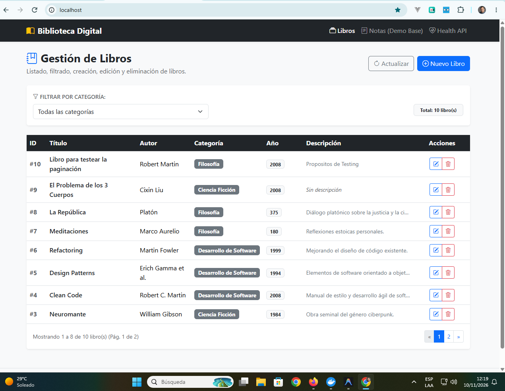
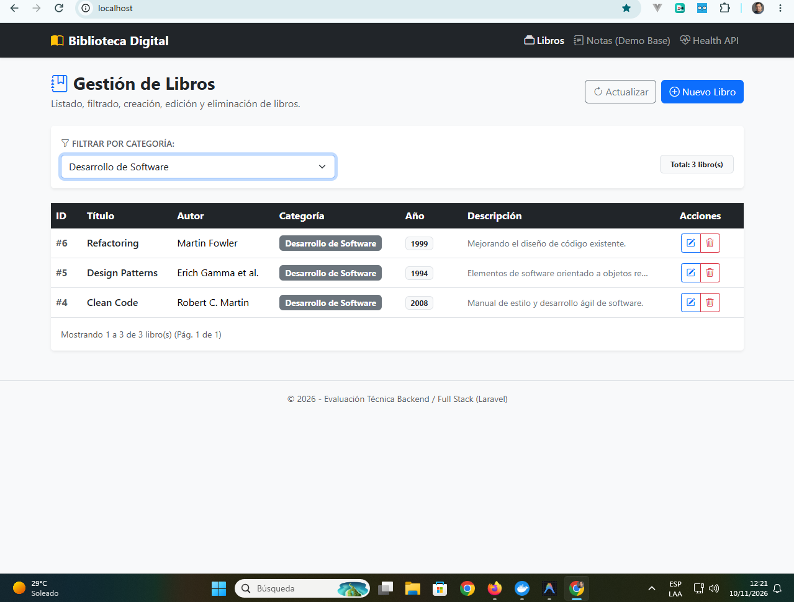
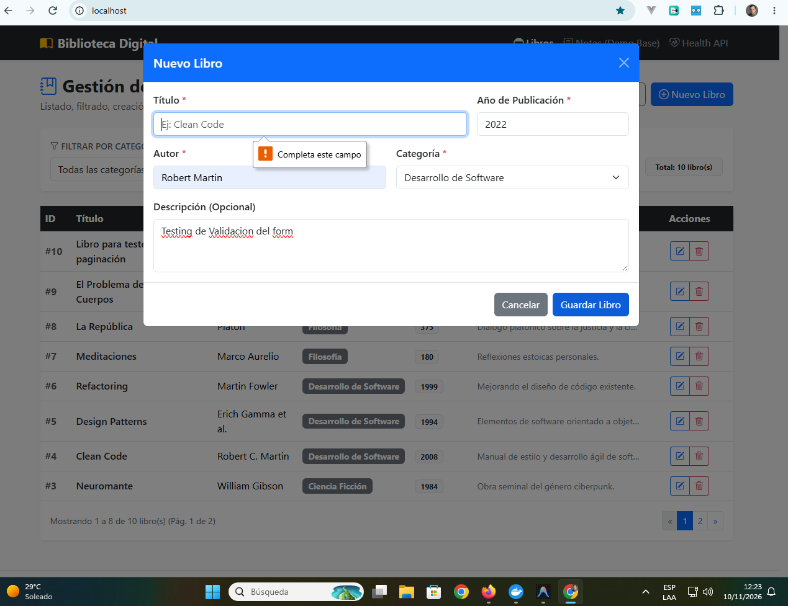
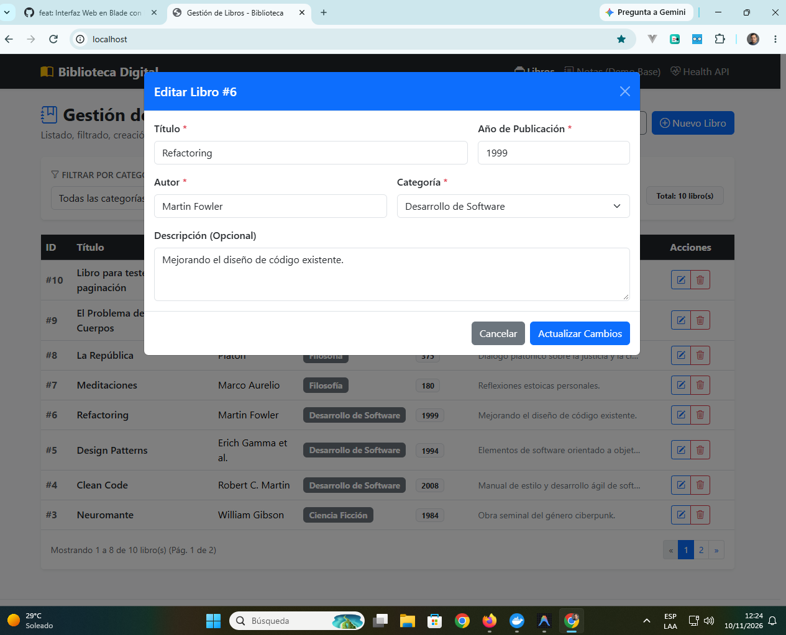
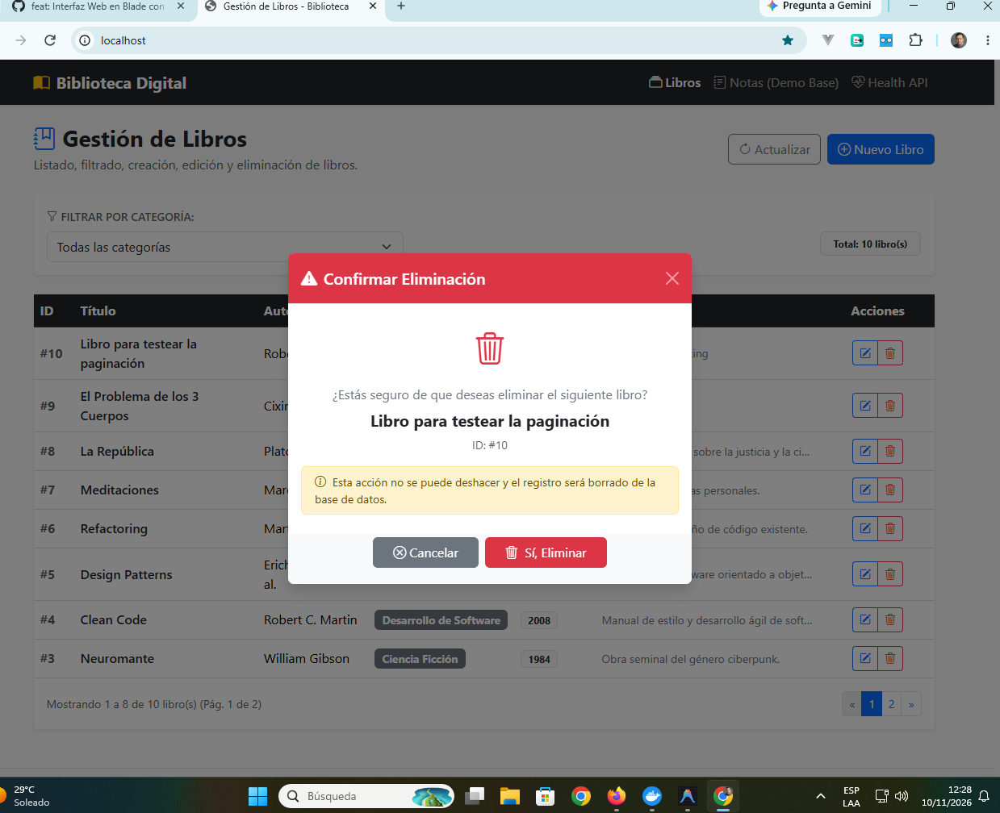
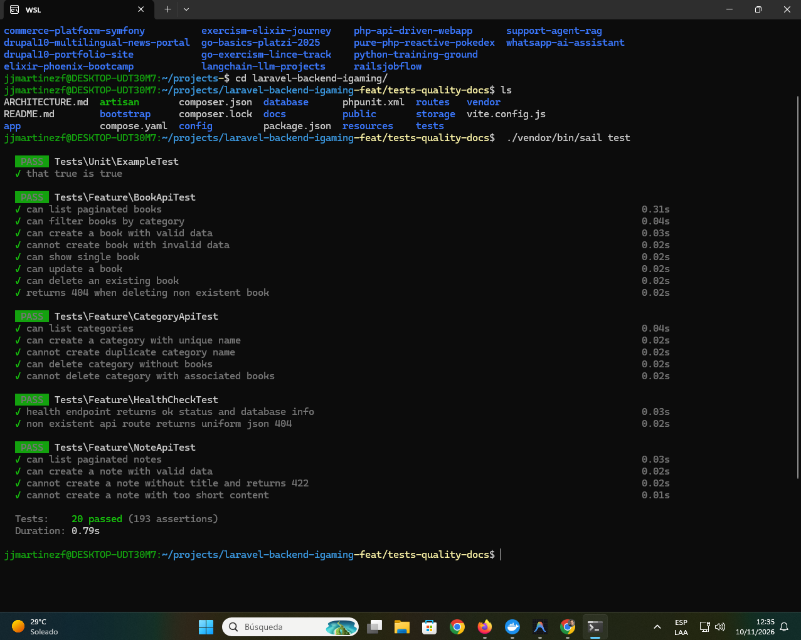

# Plataforma de Gestión de Biblioteca - Evaluación Técnica Backend / Full Stack (Laravel)

Solución completa y funcional para la gestión integral de una biblioteca de libros con soporte de categorización, filtros dinámicos, API RESTful y frontend interactivo desarrollada en **PHP / Laravel** con arquitectura por capas, transaccionalidad y buenas prácticas orientadas a alta concurrencia.

---

## 🏛️ Decisiones Técnicas y Arquitectura

1. **Patrón Arquitectónico Desacoplado (Service-Layer):**
   - **Thin Controllers:** Los controladores (`BookController`, `CategoryController`) se limitan a orquestar la solicitud, delegando el 100% de la lógica a la capa de servicios y retornando recursos JSON estandarizados.
   - **Services (`app/Services`):** `BookService` y `CategoryService` encapsulan las operaciones de lectura, escritura y las reglas de negocio.
   - **Form Requests (`app/Http/Requests`):** Validación previa estricta con mensajes personalizados en español (`StoreBookRequest`, `UpdateBookRequest`, `StoreCategoryRequest`).
   - **API Resources (`app/Http/Resources`):** Transformación predecible de datos (`BookResource`, `CategoryResource`) evitando la exposición directa de modelos Eloquent.

2. **Lógica de Negocio y Reglas Críticas:**
   - **Verificación previa a la eliminación de libros:** Se valida la existencia mediante `findOrFail()` dentro de transacciones atómicas antes de eliminar.
   - **Protección de integridad en categorías:** Se verifica activamente que una categoría no tenga libros asociados (`books_count === 0`) antes de permitir su eliminación; en caso contrario, se arroja una excepción de validación descriptiva. Adicionalmente, la base de datos cuenta con la restricción foránea `restrictOnDelete()`.
   - **Transaccionalidad Atómica:** Toda operación de mutación (crear, editar, eliminar) corre envuelta en bloques `DB::transaction(...)`.

3. **Manejo Uniforme de Errores JSON:**
   - Centralizado en `bootstrap/app.php` para que cualquier petición `/api/*` retorne siempre una respuesta estructurada con su código de estado HTTP correspondiente (404, 422, 500, etc.):
     ```json
     {
       "message": "Error de validación en la solicitud.",
       "errors": {
         "title": ["El título debe tener al menos 3 caracteres."]
       }
     }
     ```

4. **Frontend Full Stack Dinámico:**
   - Implementado en **Blade** con **Bootstrap 5** y **jQuery 3.7.1**.
   - Consumo asíncrono vía AJAX con token CSRF inyectado globalmente.
   - Paginación asíncrona de **8 en 8 registros** con recálculo dinámico.
   - Filtrado en vivo por categoría y modales de creación/edición con manejo visible de errores en los inputs (`.is-invalid`).

---

## 📸 Vistas y Capturas del Sistema

A continuación se presentan las capturas representativas de las funcionalidades implementadas en la solución:

### 1. Listado Principal con Paginación Asíncrona (8 registros por página)
Vista general de la biblioteca con metadatos de registros, badges de categorías y controles de navegación:


---

### 2. Filtrado Dinámico por Categoría en Tiempo Real
Filtro interactivo vía selector AJAX (`GET /api/v1/books?category={id}`) con recálculo dinámico de resultados:


---

### 3. Registro de Nuevo Libro con Validación en Formulario Modal
Modal interactivo con detección de campos requeridos, feedback visual (`.is-invalid`) y mensajes de error desde el servidor (422):


---

### 4. Edición de Información de Libro Existente
Modal de actualización con precarga de información y guardado atómico mediante `PUT /api/v1/books/{id}`:


---

### 5. Confirmación de Eliminación con Modal Responsive
Diálogo estilizado de confirmación con alerta preventiva y eliminación segura mediante `DELETE /api/v1/books/{id}`:


---

### 6. Ejecución de Pruebas Automatizadas (20/20 Tests en Verde)
Ejecución de la suite completa con 193 aserciones en base de datos SQLite en memoria:


---

## 🛠️ Requisitos Previos

- **Docker Desktop** (con integración WSL2 en Windows o Docker Engine en Linux/macOS).
- **Git**.

> No se requiere PHP ni Composer en la máquina host. Todo el entorno corre aislado en contenedores mediante **Laravel Sail**.

---

## 🚀 Instalación y Puesta en Marcha (Desde Cero)

### 1. Clonar el repositorio
```bash
git clone https://github.com/jlcarrascof/laravel-backend-igaming.git
cd laravel-backend-igaming
```

### 2. Configurar variables de entorno
```bash
cp .env.example .env
```
*(Por defecto configurado para MySQL 8.4 en Sail. Cuenta con configuración alternativa comentada para PostgreSQL).*

### 3. Instalar dependencias con Docker (si se clona en host limpio)
```bash
docker run --rm -u "$(id -u):$(id -g)" -v "$(pwd):/app" -w /app composer:2 composer install --ignore-platform-reqs
```

### 4. Iniciar Contenedores con Laravel Sail
```bash
./vendor/bin/sail up -d
```

### 5. Generar Application Key y Ejecutar Migraciones con Seeders
```bash
./vendor/bin/sail artisan key:generate
./vendor/bin/sail artisan migrate --seed
```

La aplicación estará lista en:
- **Frontend Interactivo (Gestión de Libros):** [http://localhost](http://localhost)
- **API Health Check:** [http://localhost/api/v1/health](http://localhost/api/v1/health)

---

## 🧪 Pruebas Automatizadas (Testing Suite)

La suite de pruebas ejecuta **20 tests de integración y 193 aserciones** en SQLite en memoria (`:memory:`) en ~1.1 segundos:

```bash
./vendor/bin/sail test
```

### Casos de prueba cubiertos:
- **Libros (`BookApiTest`):**
  - Listado paginado de libros (8 por página).
  - Filtrado de libros por categoría (`?category={id}`).
  - Detalle individual de libro por ID.
  - Creación con datos válidos (`201 Created`).
  - Validación de campos requeridos y tipos inválidos (`422 Unprocessable Content`).
  - Actualización parcial y total de libros (`200 OK`).
  - Eliminación con persistencia verificada (`200 OK`).
  - Retorno 404 uniforme al intentar borrar un libro inexistente.
- **Categorías (`CategoryApiTest`):**
  - Listado de categorías con conteo de libros.
  - Creación con nombre único.
  - Bloqueo de nombres duplicados (`422`).
  - Eliminación permitida de categoría vacía (`200 OK`).
  - **Bloqueo estricto de eliminación de categoría con libros asociados (`422`)**.
- **Infraestructura:**
  - Diagnóstico de conectividad de base de datos en `/health`.
  - Respuestas 404 globales en formato JSON estándar.

---

## 🧹 Estándar de Código (Linting)

Código formateado y validado bajo el estándar oficial de Laravel (PSR-12) con **Laravel Pint**:

```bash
./vendor/bin/sail pint
```

---

## 📡 Catálogo de Endpoints RESTful (`/api/v1`)

| Método | Endpoint | Descripción | Códigos HTTP |
| :--- | :--- | :--- | :--- |
| **GET** | `/api/v1/health` | Estado del sistema y conectividad a la BD | `200` |
| **GET** | `/api/v1/books` | Listar libros paginados (por defecto 8 por página) | `200` |
| **GET** | `/api/v1/books?category={id}` | Filtrar libros por categoría | `200` |
| **GET** | `/api/v1/books/{id}` | Obtener detalle de un libro | `200`, `404` |
| **POST** | `/api/v1/books` | Registrar un nuevo libro | `201`, `422` |
| **PUT** | `/api/v1/books/{id}` | Editar información de un libro | `200`, `422`, `404` |
| **DELETE**| `/api/v1/books/{id}` | Eliminar libro (valida existencia previa) | `200`, `404` |
| **GET** | `/api/v1/categories` | Listar categorías con conteo de libros | `200` |
| **POST** | `/api/v1/categories` | Crear nueva categoría (nombre único) | `201`, `422` |
| **DELETE**| `/api/v1/categories/{id}` | Eliminar categoría (bloquea si tiene libros) | `200`, `422`, `404` |
